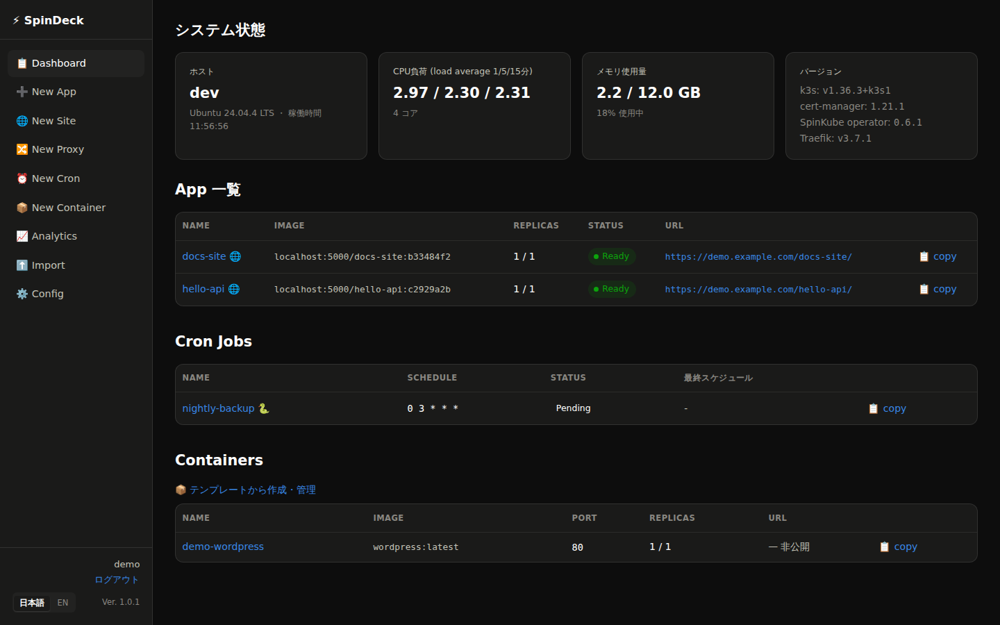
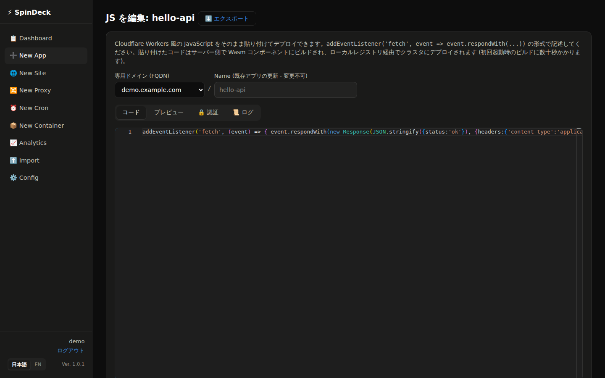
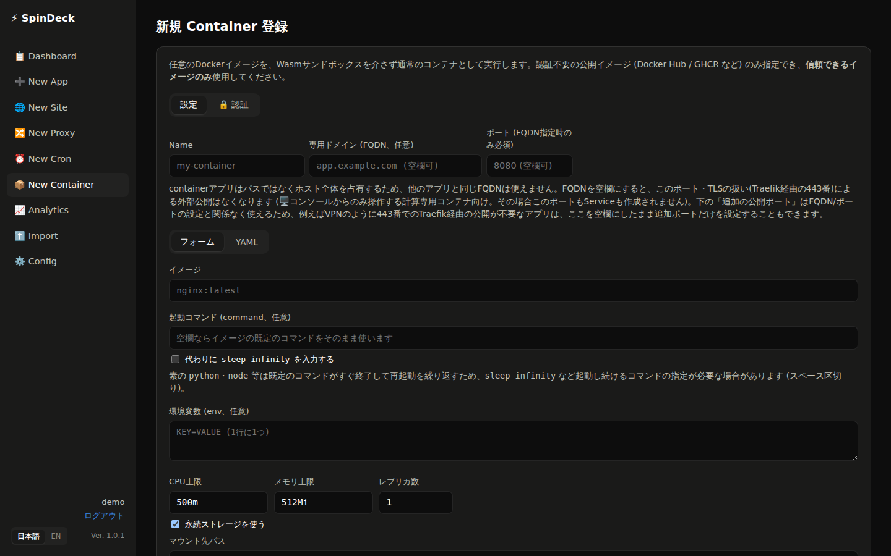
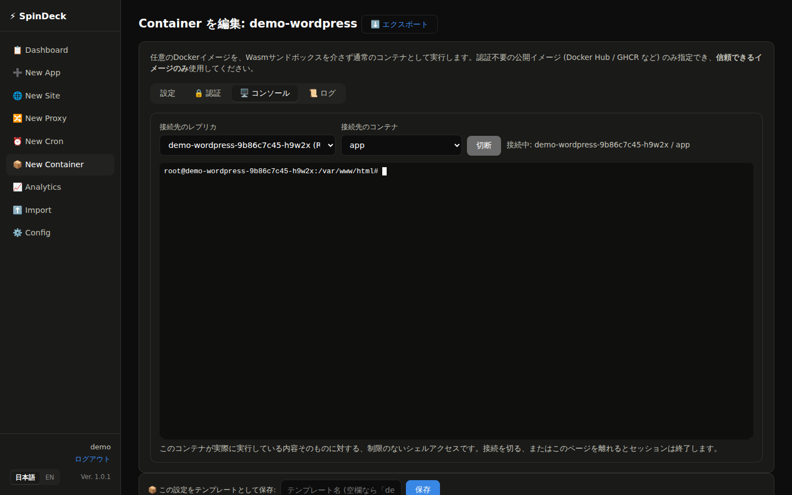
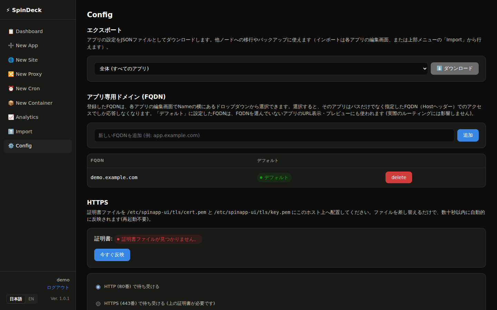
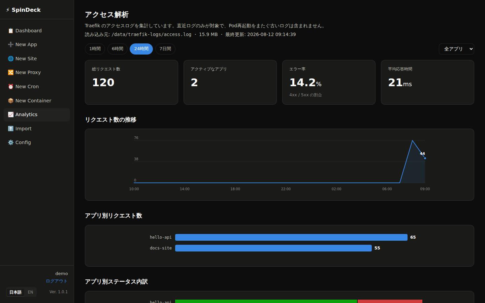

# SpinDeck

📖 [English version here](README_en.md) / 英語版はこちら

**`kubectl`を一切触らずに、ブラウザだけでアプリを公開できるセルフサービスの
Webコンソール**です。裏側では[SpinKube](https://www.spinkube.dev/)
（Kubernetes上でWebAssembly / Wasmアプリを動かす基盤）を使い、コードを
貼り付けるだけでビルド・デプロイ・公開までを自動化します。

現在のバージョン: **1.0.1**（管理画面のサイドバーにも表示されます、[リリースノート](RELEASE_NOTES.md)）。
バージョン方針は[semver](https://semver.org/lang/ja/)に従います。
[Apache License 2.0](LICENSE)で公開しています。

## SpinDeckとは

社内で「ちょっとしたAPIを1つ動かしたい」「簡単な社内ツールのフロントエンドを
公開したい」「定期実行のバッチ処理を1本組みたい」というとき、本来であれば
サーバーの用意、コンテナ化、Kubernetesマニフェストの作成、ルーティング設定、
証明書の管理…と、覚えることが山ほどあります。SpinDeckは、これら全てを
1つのWebコンソールに集約し、**Kubernetesの知識が無くても使える**ようにした
ものです。

- ブラウザ内のエディタにコードを貼り付けて「保存」を押すだけで、数秒〜
  十数秒後にはアプリが公開されています。
- サーバーへのSSHログインやコマンドライン操作は、インストール時以外
  基本的に不要です。運用は全て`/config`を含むWeb画面から行えます。
- 認証（パスワード保護・社内ログイン基盤との連携）、独自ドメイン、
  HTTPS化、アクセス状況の可視化、複数台構成による可用性向上まで、
  実運用に必要な機能を標準で備えています。

1台のサーバー（VM・LXCコンテナ・ベアメタルいずれでも可）にインストール
すれば、その日のうちに最初のアプリを公開できます。



## 主な機能

### アプリを作る（5種類）



- **New App** — VS Code風のブラウザ内エディタ（Monaco）に、
  [Cloudflare Workers](https://developers.cloudflare.com/workers/)風の
  JavaScriptコードを貼り付けるだけで、Wasmコンポーネントとして
  自動的にビルド・デプロイされます。ちょっとしたAPIやWebhookの受け口に
  最適です。
- **New Site** — 複数ファイルのHTML/CSS/JSサイトを、ビルドステップ無しで
  そのままブラウザ上に書けます（サブディレクトリ対応）。`.php`ファイルを
  含めると、追加設定なしで自動的にPHPが動く構成に切り替わります。
  画像・PDFなどのバイナリファイルのアップロードにも対応しています。
- **New Proxy** — 既に社内で動いている別サーバー・別システムへ、
  SpinDeck経由でリクエストを中継（リバースプロキシ）できます。パスごとに
  「そのまま転送」「404にする」「別パスの内容に差し替える」を選べ、
  レスポンス中のURLを書き換える高度なルールも設定できます。
- **New Cron** — PythonまたはbashのスクリプトをKubernetesの`CronJob`
  として定期実行できます（SpinKube自体にはcron/タイマー機能が無いため、
  この種類だけWasmではなく通常のコンテナとして動作します）。メール送信
  （`send_mail(宛先, 件名, 本文)`）やURL取得（bashの`download(url, 保存先)`）
  がライブラリ無しですぐ使えます。
- **New Container** — 任意のDockerイメージを、Wasmサンドボックスを介さない
  通常のコンテナ（`Deployment`）としてそのまま実行します。CPU/メモリ上限、
  起動コマンドの上書き（既定コマンドがすぐ終了するイメージ向け）、
  環境変数、レプリカ数（自動で負荷分散）、専用ドメイン（省略すると外部
  公開せず、🖥️コンソールタブからの操作専用にできます。この場合ポート/
  Serviceも作成されません）、HTTPSをSpinDeck側で終端するかコンテナへ
  そのままパススルーするかの選択、オン/オフとマウント先パスを指定できる
  永続ストレージ（既定は`/data`）、アプリごとのBasic/OIDC認証（終端
  モードのみ、専用ドメインは自由入力のままで構いません）が設定
  できます。**サイドカーコンテナ**を追加すれば、WordPress+MySQLのように
  連携する複数コンテナを同じPod内にまとめてデプロイでき（`localhost`で
  相互通信、コンテナごとに独立した永続ストレージのマウント先を指定可能）、
  クラスタ内Pod間通信を制限するegressポリシーの制約を受けずに構成できます。
  ブラウザ上のインタラクティブターミナル（`kubectl exec`相当）や
  ログ閲覧タブでコンテナに直接入って操作・確認することも、フォームでは
  表現しきれない設定（複数コンテナの詳細な調整、追加volumeなど）を
  Deployment/Serviceの生YAMLとして直接編集することもできます。他の種類と
  違い、公開イメージをそのまま実行するため信頼できるイメージのみ
  指定してください。



New App/Site/Proxy/Cronには**ブラウザ内でのライブプレビュー**が付き、
`https://<公開ホスト名>/<アプリ名>/`で自動管理されるTraefikルート経由で
公開されます。New Containerは専用ドメインを持つ独立したホストとして
公開される点が異なります（詳細は[`docs/GUIDE.md`](docs/GUIDE.md)を
参照してください）。



### 認証・アクセス制御

- **アプリごとのHTTP Basic認証** — ユーザー名/パスワード1組でシンプルに
  保護できます。
- **アプリごとのOIDC認証** — コンソール自体のKeycloakログインを再利用し、
  「このアプリを見て良いユーザー名」を一覧で指定できます。
- **アプリごとの専用ドメイン(FQDN)指定** — コンソール自体のログインとは
  独立して、アプリを特定のドメインに紐付けられます。
- **コンソール自体へのアクセス制限** — `/config`から、コンソールに
  ログインできるユーザー名を一覧で制限できます（デフォルトは、設定した
  Keycloakレルムでログインできる人なら誰でも管理可能）。
- **コンソール自体のログイン方式を選べる** — 既定はユーザー名/パスワードの
  ローカルアカウント（`install.sh`実行時に管理者アカウントを1つ自動作成、
  複数登録可）で、Keycloak等のOIDC IDプロバイダが用意できる場合はそちらに
  切り替えることもできます。`/config`からいつでも一方から他方へ切り替え
  可能です。

### 運用機能





- **分析ダッシュボード** — リクエスト数、エラー率、応答時間、アクセス先
  Top、アプリごとのステータス内訳を、別途監視基盤を用意せずTraefikの
  アクセスログだけから表示します。
- **ネイティブHTTPS対応** — Traefik自身が直接TLSを終端できます
  （`/config`の「HTTPS」セクション）。サーバー上に証明書・鍵ファイルを
  配置して切り替えるだけで、ファイルを差し替えるだけで自動的に反映されます
  （再起動不要）。管理画面自体も同じ経路で公開するよう選べます
  （デフォルトは今まで通り`:8080`への直接アクセスのみ）。
- **ピア間複製** — `/config`から他のSpinDeckノードを登録しておくと、
  アプリ・サイト・プロキシのデプロイ／編集／削除が自動的にそのノードへも
  反映されます（可用性のため）。各ノードはあくまで完全に独立した単体の
  k3s/SpinKube環境のままで、クラスタ自体が統合されるわけではなく、
  deploy/delete操作だけが同期されます。
- **Wasmランタイムのスタックしたプロセスを自動復旧** — `containerd-shim-spin`
  （依存している外部プロジェクト）には、コンテナ起動に失敗した際にプロセスが
  正常終了せず残り続け、それ以降の新規Wasmコンテナ起動まで巻き添えでブロック
  してしまう既知の不具合があります。15分ごとに動く`spin-shim-recovery.timer`
  が「ログが一度も出ないままCrashLoopBackOffを繰り返している」アプリを検知し、
  スタックしたプロセスを自動的に片付けてアプリを再起動します。
- 公開ホスト名や登録済みドメインなど、その他の設定も**`/config`**
  ページから、再デプロイ不要で変更できます。

### セキュリティ

- **デフォルトで堅牢** — CSRF対策、セキュアなセッションCookie、
  セキュリティヘッダー、コンソールログインへのブルートフォース対策
  （試行回数制限）が標準で組み込まれています。
- **コンソール自体も最小権限で動作** — `kubectl`を実行するコンソール本体は
  クラスタ全体を操作できるadmin権限ではなく、実際に使う名前空間・
  リソース種別だけに絞った専用のServiceAccount/Roleで動作します。
  万一コンソール自体に脆弱性があっても、影響範囲を最小限に抑えます。
- **`NetworkPolicy`によるegress制限** — デプロイされた全アプリ・CronJobの
  外向き通信を、パブリックインターネットと自分のLANまでに制限し、
  Kubernetesクラスタ自身の内部（APIサーバーや他サービス）やクラウドの
  メタデータエンドポイントには到達できないようにします。「セルフサービスで
  コードを実行できる」という機能上どうしても生まれる「踏み台」リスクを
  ネットワークレベルで封じ込めます。
- **New Containerの生YAML編集にも歯止め** — `privileged`・ホストの
  ネットワーク/PID/IPC名前空間の共有・管理外の`hostPath`マウント等、
  ホストへ抜け出せる設定は自由編集モードでも拒否されます。
- コンテナレジストリは`localhost`限定でバインドされ、外部やPodネットワーク
  からは到達できません。

## クイックスタート

Ubuntu 24.04 / 26.04のまっさらなホスト（VM、LXCコンテナ、ベアメタルのいずれでも可）で:

```bash
sudo apt-get update && sudo apt-get install -y git
git clone <このリポジトリのURL> spindeck
cd spindeck
sudo ./scripts/install.sh
```

これで、k3s・SpinKube・ローカルコンテナレジストリ・Traefik・コンソール
本体まで、スタック全体が自動的にインストール・設定されます。所要時間は
回線速度にもよりますが、おおむね10〜20分程度です。

インストール完了後は `http://<サーバーのIP>:8080/` を開いてログインして
ください。各手順の詳細と、動作に必要なKeycloak（OIDC）の設定方法は
[`docs/INSTALL.md`](docs/INSTALL.md)を、実際の使い方は
[`docs/GUIDE.md`](docs/GUIDE.md)を参照してください。

## 動作要件

- Ubuntu 24.04 / 26.04（VM・LXCコンテナ・ベアメタルのいずれでも可。他のディストリ
  ビューションでは未検証です）
- インターネットへの疎通（各種パッケージ・コンテナイメージの取得に必要）
- ログイン方式は2通りから選べます。既定はコンソール内蔵のローカルアカウント
  （ユーザー名/パスワード、`install.sh`実行時に管理者アカウントを自動作成）で、
  Keycloakは不要です。OIDC対応のログイン基盤（[Keycloak](https://www.keycloak.org/)
  を想定して作られていますが、OIDC準拠であれば他の製品でも動作するはずです）が
  用意できる場合はそちらに切り替えることもでき、いつでも`/config`から
  切り替え可能です。
- 最小構成であれば1台のマシンで完結します（CPU 2コア・メモリ4GB程度から
  動作しますが、動かすアプリの数や負荷に応じて余裕を持たせてください）

## アーキテクチャ

```
                 ┌─────────────────────────────────────────┐
   ブラウザ ────▶ │ Traefik (k3s内蔵のingress)                │
                 │  アプリごとのルート: /<name>/... → Service │
                 └───────────────┬───────────────────────────┘
                                 │
                 ┌───────────────▼───────────────────────────┐
                 │ k3s (シングルノード) + SpinKube             │
                 │  SpinApp CRD → Wasmコンポーネント           │
                 │  (Spin/containerd-shim-spin)、             │
                 │  ローカルOCIレジストリ(localhost:5000)から  │
                 │  pull                                       │
                 │  ※New Containerのみ通常のDeployment        │
                 │    （Wasmを介さない）として動作します        │
                 └───────────────┬───────────────────────────┘
                                 │ kubectl / spin registry push
                 ┌───────────────▼───────────────────────────┐
                 │ SpinDeckコンソール (systemd, Flask)         │
                 │  /opt/spinapp-ui — JS/サイトをWasmに        │
                 │  ビルドし、SpinAppとしてデプロイ、          │
                 │  ルーティングを管理する                     │
                 └───────────────────────────────────────────┘
```

コンソール自体（`app.py`）はKubernetesのPodとしてではなく、対象ホスト上に
直接systemdサービスとして常駐します。ユーザーが書いたコードをその場で
Wasmコンポーネントへビルドし、ローカルレジストリへpushした上で、
Kubernetes（k3s）のAPIを叩いてSpinApp/Service/IngressRoute等を作成・更新
します（New Containerだけは、ビルドを伴わず、指定された公開Dockerイメージを
そのまま`Deployment`として作成・更新します）。

## 設定

実行時の設定は`/etc/spinapp-ui/env`（Keycloak・レジストリ・namespaceなど
— 全変数は[`deploy/env.example`](deploy/env.example)を参照）と、
コンソール自体の**`/config`**ページ（登録済みドメイン、HTTPS、認証、
ピアノードなど、再起動不要で変更できる設定）の2箇所にあります。

## ドキュメント一覧

- [`docs/INSTALL.md`](docs/INSTALL.md) — インストール手順の詳細解説。
  `install.sh`が行う各ステップの説明と、非対話的インストールの方法、
  Keycloakの設定方法を含みます。
- [`docs/GUIDE.md`](docs/GUIDE.md) — 使い方ガイド。このシステムを初めて
  触る方向けに、各機能の使い方をやさしく説明しています。

## リポジトリ構成

```
scripts/
  install.sh                まっさらなUbuntu 24.04/26.04ホストへの一括インストーラ
  update.sh                 既にインストール済みのノード（ピア等）へ
                            app.py/テンプレート/js-templateを再デプロイし
                            再起動する -- コード変更の反映用（新規インストール
                            用ではない）
  backup.sh                 /data(永続データ)と登録済み全アプリの設定を
                            /data/backup/へtar.gzでまとめてバックアップ
  upgrade.sh                OSパッケージ + k3s/cert-manager/SpinKube
                            operatorを最新版へ更新（Traefikはk3s同梱の
                            ため個別ステップなし）。クラスタ全体に影響する
                            最もブラスト半径の大きいスクリプト
  healthcheck.sh             全アプリ種別(container/js/site/proxy/cron)を
                            使い捨てリソースで実際にエンドツーエンド
                            デプロイ・削除し、CPU/Recreate/追加ポート/
                            SSRF境界などの既知の回帰も確認するスモーク
                            テスト。upgrade.sh実行後に流すことを想定
docs/
  INSTALL.md / INSTALL_en.md install.shが行う手順の詳細解説（日本語/英語）
  GUIDE.md / GUIDE_en.md     使い方ガイド -- インストール後、実際に何を
                            どう使うか（日本語/英語）
spinapp-ui/                Flaskコンソール本体（app.py + templates/）
js-template/               「New App」で使われるJS→Wasmビルドテンプレート
deploy/
  spinapp-ui.service        systemdユニット
  env.example                設定ファイルのテンプレート（実際の値を埋めて使う）
  k3s/                      k3s + containerdの設定
  k8s-manifests/            SpinKubeのCRD/RuntimeClass、ローカルレジストリ、
                            Traefikの設定、egress用NetworkPolicy、
                            コンソール自体の最小権限RBAC
```

## ライセンス

[Apache License 2.0](LICENSE)の下で公開しています。著作権表示は
[`NOTICE`](NOTICE)を参照してください。

このプロジェクトが依存する主なソフトウェア（[SpinKube](https://www.spinkube.dev/)、
[Spin](https://www.fermyon.com/spin)、[k3s](https://k3s.io/)、
[Traefik](https://traefik.io/traefik/)、Flask等のPythonライブラリ）は、
それぞれ別のライセンスの下で配布されています。本リポジトリはこれらの
インストール・設定を自動化するものであり、それら自体を同梱・改変・
再配布するものではありません。
